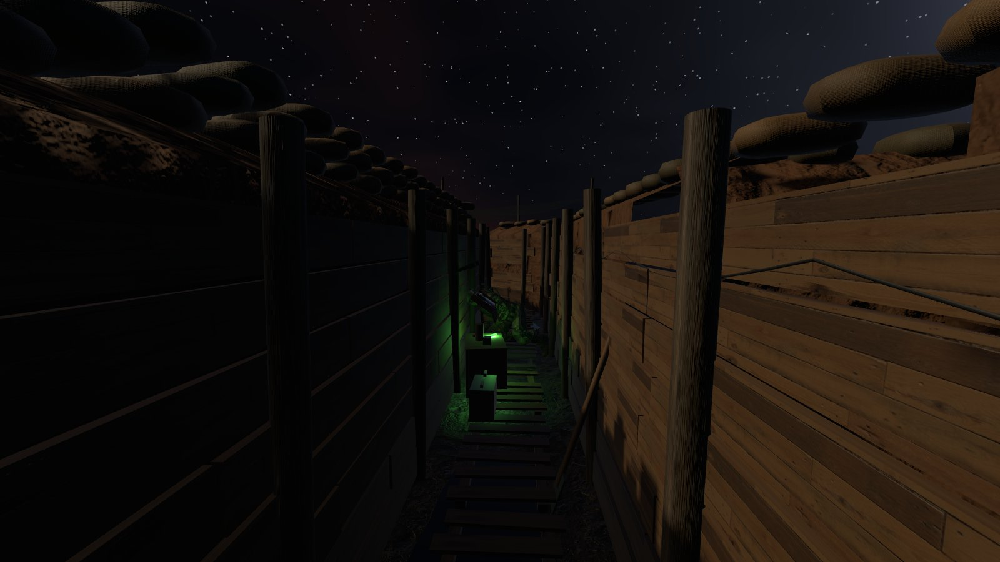

# Бауыр — Field Medic VR

Реалистичный VR-тренажёр боевого медика (TCCC / CLS) для **Meta Quest 3S**.
Ночь, окоп первой линии. Ваш товарищ Ерлан раз за разом получает разные ранения, и вы спасаете его **своими руками**.
Жгут, тампонада, окклюзионная наклейка, игла, НФВ, эвакуация волоком, перекат на бок — всё делается пошагово и физически, без кнопки «наложить жгут».
Интерфейс и голос на русском и казахском (переключатель RU/KZ).



## Что внутри
- **Обучение:** 5 уроков (жгут CAT; тампонада и давление; наклейка и игла; волок и перекат; дыхательные пути / НФВ). Голос инструктора, чек-лист, «призрачная рука» со стрелкой, монитор показателей. Обстрела нет, 3-минутное удержание идёт в 6 раз быстрее.
- **Сценарии** (у каждого случайная сторона ранения и возможный второй удар):

| № | Название | Что случилось | Что отрабатывается |
|---|---|---|---|
| S1 | «Сброс» | дрон сбросил ВОГ, артериальное кровотечение бедра | жгут под огнём ≤ 60 с, запись времени, волок, осмотр |
| S2 | «Снайпер» | сквозное ранение груди | наклейка на выдохе, перекат, выходное отверстие, игла при напряжённом пневмотораксе |
| S3 | «Мина» | противопехотная мина в ходе сообщения, отрыв стопы | жгут на культю, путь только по своим следам |
| S4 | «Миномёт» | паховая рана (узловое кровотечение) | тампонада, 3 мин давления, израильский бинт |
| S5 | «FPV» | осколки: голень, плечо, лицо + скрытая рана | полный осмотр, перекат, тампонада ягодицы |
| S6 | «КАБ» | контузия, без сознания | дыхательные пути: НФВ, восстановительное положение |
| S7 | «Под огнём» | жгут уже наложен, начинается обстрел | волок рывками между разрывами, жгут сполз — перепроверить и докрутить |
| S8 | «До рассвета» | эвакуации не будет до утра | переоценка, конверсия жгута, наблюдение (пропуск времени) |

- **Экзамен:** случайный сценарий и вариант, без подсказок.
- **Настройки:** язык RU/KZ, подсказки, уровень натурализма, стоя/сидя, ведущая рука, поворот 30°/45°.
- **Разбор:** балл 0–100, выжил/погиб (с причиной), исход для конечностей, время до остановки кровотечения, кровопотеря, ошибки с пояснением «что было бы в реальности», хронология, лучший результат.

Ход каждого прогона: брифинг → инцидент → **помощь под огнём** (не поднимать голову над бруствером) → волок в блиндаж → **помощь в укрытии (MARCH)** → запрос MEDEVAC по рации → ожидание эвакуации (время сжато) → разбор.

## Как открыть проект
1. Unity Hub → *Add project from disk* → `C:\TacticalMedicine`. Редактор **Unity 6.3 LTS (6000.3.26f1)** с модулем Android Build Support.
2. Платформа уже переключена на Android (Quest). Первое открытие импортирует пакеты, это несколько минут.
3. Открыть сцену `Assets/Scenes/Main.unity` → Play. Вы окажетесь у доски-меню в блиндаже.
4. Сцена генерируется скриптом: меню *FieldMedic → Scenes → Build Main Scene* (`MainSceneBuilder.Build`). Руками YAML сцен не правим.

## Управление
**Quest (контроллеры или руки):**
- grip — схватить; trigger — точное действие (ножницы, маркер, PTT, клик лучом по доске);
- A — перезапуск после попадания; стик — поворот рывком или подтягивание при волоке;
- руки (hand tracking) работают так же: щипок — курок, кулак — хват; кнопки доски нажимаются пальцем.
- **Рация** на левой лямке: красная кнопка PTT, 4 нажатия = запрос MEDEVAC (место → раненые → ранения и время жгута → особые).
- **Часы** на левом запястье: время, T+ с момента ранения, фаза, отсчёт эвакуации. В S8 кнопка «+» перематывает время.
- Удерживать B 2 с — калибровка роста.

**Симулятор в редакторе (без шлема):**

| Клавиша | Действие |
|---|---|
| Мышь (клик — захват, Esc — отпустить) | смотреть |
| WASD / C | ходить / присесть |
| ПКМ + мышь, колесо | двигать активную руку / глубина руки |
| ЛКМ | хват; на доске — нажать кнопку под курсором |
| Enter | нажать кнопку доски под прицелом |
| G | зафиксировать хват (рука держит, пока переключаетесь) |
| Tab | сменить руку |
| F / СКМ / Shift+ЛКМ | курок |
| Q / E | вращать кисть (вороток жгута) |
| X | подтягивание при волоке |
| Space | основная кнопка |
| Y / L (удерживать — белый) | налобный фонарь красный / белый |
| M | рация PTT (строка MEDEVAC) |
| T | S8: перемотка к следующей вехе |
| R | перезапуск после попадания |

**Первый прогон S1 на ПК:** СЦЕНАРИИ → 1 → ПУСК.
1. Дождаться сброса, присесть (C), подойти к Ерлану.
2. ЛКМ — взять его жгут из подсумка. Петлю провести через стопу, поднять высоко на бедро и отпустить.
3. Взять красный хвост ленты и потянуть.
4. Взять вороток, крутить Q/E, пока не прекратится фонтан, и отпустить у клипсы.
5. Потянуть ленту TIME и написать время маркером (F).
6. Взять ручку за воротом бронежилета и пятиться (S) в блиндаж.
7. В укрытии: надеть перчатки, сделать осмотр на кровь (медленно провести открытой ладонью по телу), накрыть термоодеялом.
8. Нажать M 4 раза (MEDEVAC) и дождаться разбора.

## Установка на Quest 3S
APK: `Builds/FieldMedicVR.apk` (копия на рабочем столе: `C:\Users\user\Desktop\FieldMedicVR.apk`). В git он не хранится.
1. На шлеме включить **режим разработчика** (приложение Meta Horizon на телефоне → Устройство → Режим разработчика), подключить шлем по USB-C и разрешить отладку в шлеме.
2. **Meta Quest Developer Hub:** Device Manager → Apps → перетащить APK в окно.
   **Или adb:**
   ```
   "C:\Program Files\Meta Quest Developer Hub\resources\bin\adb.exe" install -r C:\Users\user\Desktop\FieldMedicVR.apk
   ```
3. На шлеме: Библиотека → фильтр «Неизвестные источники» → **«Бауыр — Field Medic VR»**. Встаньте в центре свободной игровой зоны (нужно примерно 2×2 м). У стен включается passthrough.

Сборка APK из командной строки: `. .\tools\unity.ps1; Invoke-UnityBatch -Method FieldMedic.EditorTools.BuildTools.BuildAndroid -TimeoutMin 60`. Параметры: IL2CPP, ARM64, Vulkan, OpenXR (Meta Quest), URP Mobile. Первая сборка идёт 20–40 мин, повторная около 10 мин.

## Тесты
- EditMode (медицинская модель, сценарии, разбор, конверсия жгута, настройки сборки): `. .\tools\unity.ps1; Invoke-UnityTests -Platform EditMode`. Быстрая проверка без Unity: `cd tools/medtest; dotnet run`.
- PlayMode: `Invoke-UnityTests -Platform PlayMode -Category "!Screenshots"`. `ScenarioBotTests` прогоняет все 8 сценариев ботом-медиком: при правильном протоколе раненый выживает с баллом ≥ 85, а типичная ошибка попадает в разбор.
- Скриншоты: `Invoke-UnityTests -Platform PlayMode -Filter FieldMedic.Tests.ScenarioScreenshots` → `docs/screens/`.
- Производительность: `Invoke-UnityBatch -Method FieldMedic.EditorTools.PerfReport.OptimizeAndRun` → `docs/PERF.md`.

## Как записать настоящие голоса
Сейчас все голоса — заглушки TTS (Windows Irina с обработкой). Казахские реплики произносятся фонетически.
- Полный сценарий реплик раненого с эмоциями и подачей: **`docs/VOICE_SCRIPT.md`** (таблица id / RU / KZ).
- Формат записи: моно WAV, 44,1 или 48 кГц, 16 бит, без реверберации, пик около −1 dBFS, тишина по краям обрезана.
- Имя файла: `<id>_ru.wav` / `<id>_kz.wav`. Дополнительные дубли: `<id>_ru_2.wav`, `_3` — выбираются случайно.
- Куда класть:
  - раненый: `Assets/Audio/Voice/` (список в `tools/voice_lines.tsv`; после добавления новых id запустить *FieldMedic → Casualty → Rebuild Voice Bank*);
  - командир по рации и инструктор: `Assets/Resources/Radio/` (список в `tools/radio_lines.tsv`).
- Достаточно перезаписать файл с тем же именем, Unity подхватит его сам.

## Известные ограничения
- **На шлеме ещё не проверялось** (ночью шлема не было). Производительность оценена статически (`docs/PERF.md`): около 86 тыс. треугольников в кадре и около 37 draw calls. На устройстве нужно проверить OVR Metrics Tool.
- Голоса — заглушки TTS, казахские фонетические.
- Руки игрока — временные перчатки. «Призрачная рука» в обучении — простая модель.
- Текст сделан встроенным шрифтом (TextMesh). В редакторе казахские буквы есть. Если на Quest будут квадраты, нужно подключить шрифт Noto Sans.
- Части капель крови иногда вытягиваются в полосы (частицы).
- Бот-тесты в двух местах подстраховываются вызовом протокола, если скриптовая рука промахивается: наклейка на спину (S2) и тампонада ягодицы (S5). Игрок делает это руками.

## Следующие шаги
1. Первый запуск на Quest 3S: масштаб, читаемость текста, хват руками, 72 fps (OVR Metrics Tool).
2. Записать живые голоса RU/KZ (носитель казахского).
3. Настоящие модели рук и перчаток, полировка крови (капли, пятна), шрифт с гарантированной кириллицей KZ.
4. Ещё варианты сценариев и осложнений; режим экзамена с рейтингом.

## Сторонние ресурсы
Только CC0 / CC-BY, полный список — в `ATTRIBUTION.md`.
